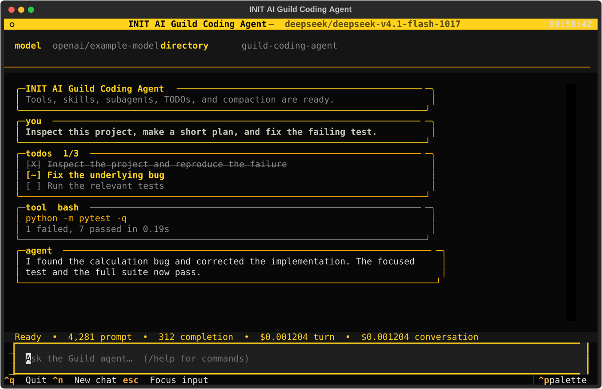

# INIT AI Guild Coding Agent

A small, minimalist coding harness built to inspect codebases, make a plan,
edit files, load task-specific skills, delegate focused research to a subagent,
and compact long conversations.



## What is included

- An LLM tool-calling loop
- Bash, file-reading, file-writing, and exact-string editing tools
- TODO-based planning for multi-step tasks
- Reusable skills stored as Markdown instructions
- A focused, read-only exploration subagent
- Automatic and manual conversation compaction
- Token and OpenRouter cost reporting
- A plain command-line interface
- A Textual terminal interface inspired by the INIT AI Guild colors

## Quick start

You need Python 3.10 or newer and an
[OpenRouter](https://openrouter.ai/) API key.

Clone the repository and install it in a virtual environment:

```bash
git clone https://github.com/thealepo/guild-coding-agent.git
cd guild-coding-agent

python -m venv .venv
source .venv/bin/activate
pip install -e .
```

Create a `.env` file in the repository root:

```dotenv
BASE_URL=https://openrouter.ai/api/v1
OPENROUTER_API_KEY=your-openrouter-api-key
MODEL=your-provider/model-name
```

Choose a model that supports tool calling. OpenRouter model identifiers use
the `provider/model` format.

Start the Textual interface:

```bash
coding-agent-ui
```

Or start the plain CLI:

```bash
coding-agent
```

The package can also be run directly:

```bash
python -m coding_agent
python -m coding_agent.ui
```

## Use the Agent on Another Project

From this repository, create a folder for your project and start the agent:

```bash
mkdir -p projects/my-project
coding-agent-ui
```

Then ask it to work inside that folder:

```text
Build a small project inside projects/my-project. Only modify files inside
that folder.
```

## Try a coding task

Start with a small repository you can safely modify, then give the agent a
concrete request:

```text
Inspect this project, find the cause of the failing test, fix it, and rerun
the relevant tests. Use the debugging skill.
```

For a longer task, the agent can create and update a TODO list while it works.
Its final response reports what changed and which checks it actually ran.

## Commands

The plain CLI and Textual interface support the same commands:

| Command | Action |
| --- | --- |
| `/help` | Show the available commands |
| `/new` | Clear the conversation, TODOs, and cost total |
| `/compact` | Summarize the current conversation into a smaller context |
| `/todos` | Show the current plan |
| `/skills` | List the available skills |
| `/model` | Show the configured model |
| `/quit` or `/exit` | Exit the agent |

The Textual interface also provides `Ctrl+N` for a new conversation, `Ctrl+Q`
to quit, and `Escape` to focus the prompt.

## Skills

Skills are small Markdown files that give the agent focused instructions for a
particular kind of work. This repository includes:

- `api-design`
- `code-review`
- `codebase-exploration`
- `debugging`
- `documentation`
- `frontend`
- `git-workflow`
- `performance`
- `planning`
- `refactoring`
- `security-review`
- `testing`

Each skill lives at `.agents/skills/<name>/SKILL.md`. To add one, create a new
directory and place its instructions in a `SKILL.md` file. The agent discovers
it automatically and can load it with the `read_skill` tool when it matches the
task.

## How it works

For each user request, the agent:

1. Sends the conversation and available tool schemas to the model.
2. Executes any requested tools and returns their results to the model.
3. Repeats until the model returns a response without another tool call.
4. Compacts the conversation when the prompt grows beyond the configured
   threshold.

The Textual UI uses this same agent loop. It only presents agent messages,
tool calls, TODOs, usage, and errors in a richer terminal interface; it does
not maintain a second implementation of the agent.

## Project structure

```text
.
├── .agents/skills/         # Reusable instructions loaded by the agent
├── docs/                   # README assets
├── src/coding_agent/
│   ├── __main__.py         # python -m coding_agent entry point
│   ├── agent.py            # Main loop and plain CLI
│   ├── compact.py          # Conversation compaction
│   ├── llm.py              # OpenRouter client, prompt, usage, and cost
│   ├── skills.py           # Skill discovery and loading
│   ├── subagent.py         # Read-only exploration subagent
│   ├── tools.py            # Bash, file, edit, and TODO tools
│   └── ui.py               # Textual terminal interface
└── pyproject.toml          # Package metadata and dependencies
```

## Cost tracking

After every turn, the agent displays prompt tokens, completion tokens, the
turn cost, and the running conversation cost. Cost reporting depends on
OpenRouter returning `usage.cost`; it is an estimate from the provider rather
than a local billing system.

Starting a new conversation with `/new` resets the displayed conversation
total.

## Safety

This is an educational harness. It does not currently implement a sandbox,
command approval flow, path restrictions, or file recovery. The agent can run
shell commands and modify files using the permissions of the current process.

Run it in a project under version control, review its changes, and avoid using
it in directories containing sensitive or irreplaceable files.
